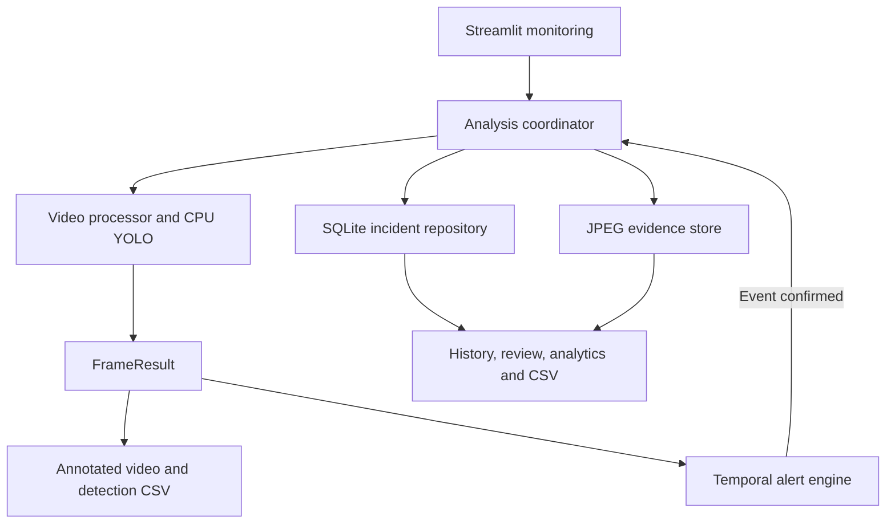

# Architecture

`app.py` loads settings, initializes incident storage, and renders the four
Streamlit tabs. The video CLI continues to use the same detection and CSV modules.

| Boundary | Responsibility |
| --- | --- |
| `detection/model.py` | Loads an explicit trusted local checkpoint, checks actual class names, and predicts pixel-coordinate detections on CPU (single frame or batch). `default_checkpoint()` is the shared rule: fine-tuned model, then OIV7. |
| `detection/demo_cache.py`, `detection/annotated_video.py` | Video demo only: cached model boxes per Mendeley video, confidence filtering, IoU facts, and H.264 rendering with GT (green) and model (red) boxes. |
| `data/mendeley_videos.py` | Lists Mendeley demo videos and reads their COCO boxes (1-based frame ids to 0-based). |
| `ml/` | Course experiment, independent of the apps: data preparation, split v2, features, EDA, classical models, YOLO export/evaluation, comparison and report evidence. `ml/predict.py` serves `predict_app.py`. |
| `detection/video_processor.py` | Owns the capture, annotates processed frames, yields `FrameResult`, and validates the optional encoded output. |
| `detection/export.py` | Shares the frame-level CSV schema between the CLI and coordinator. |
| `incidents/alert_engine.py` | Keeps per-run temporal state and emits deterministic IDs based on the run and confirming frame. |
| `incidents/incident_manager.py` | Creates run records, streams output and detection CSV, persists confirming frames, and records run completion or failure. |
| `storage/` | Owns versioned SQLite schema, transactions, records, review metadata, confined JPEG evidence, and incident CSV encoding. |
| `ui/` | Owns upload staging, widget state, checkpoint cache, live preview, review forms, and analytics. |
| `data/` | Parses and exports datasets independently of the dashboard. |
| `utils/config.py` | Loads validated configuration using defaults, project `.env`, then process environment. |

The alert window counts processed observations and skipped source frames add no
observations. The engine uses source timestamps, rejects out-of-order input, and
clears candidate history across configured gaps. An unobserved gap cannot establish
absence. A previously confirmed episode rearms after configured consecutive
observed misses. On a new qualifying observation, another incident can be emitted
once the cooldown from the previous incident has elapsed. The highest-confidence
qualifying box on the confirming frame represents the event. Multiple boxes on a
frame count as one observation and remain available in the detection export.

On confirmation, an immutable JPEG is staged and published under generated names.
SQLite rows are inserted after the evidence write, and a failed insert removes the
newly created evidence. A later run failure records failed status while retaining
earlier valid incidents. The schema uses per-operation connections, foreign keys,
unique event identifiers, and a version check that rejects unknown schemas without
deleting data. Abrupt process termination can leave a running record or an orphaned
snapshot between publication and database commit.

A session keeps run result paths and scalar statistics. Frames are streamed, and
the cached Ultralytics predictor is protected by a lock during each inference call.
Cache keys include checkpoint path, file revision, confidence, and image size.
`data/` and the evaluator remain available without Streamlit.

`demo_app.py` runs a separate presentation process. The playlist iterator wraps
`process_video` with an alternate annotation style and no output writer. The
Streamlit script replaces one inline image and status together, keeping only
recent timing samples. It closes the active capture on disconnect or exit and
shares the same checkpoint cache implementation as the dashboard.

`predict_app.py` and `video_demo_app.py` are separate Streamlit entry points. The first
uses `ml/predict.py` with the validation-chosen thresholds; the second reads cached boxes
from `outputs/demo_cache/` and never calls the model unless asked for an uncached video.
